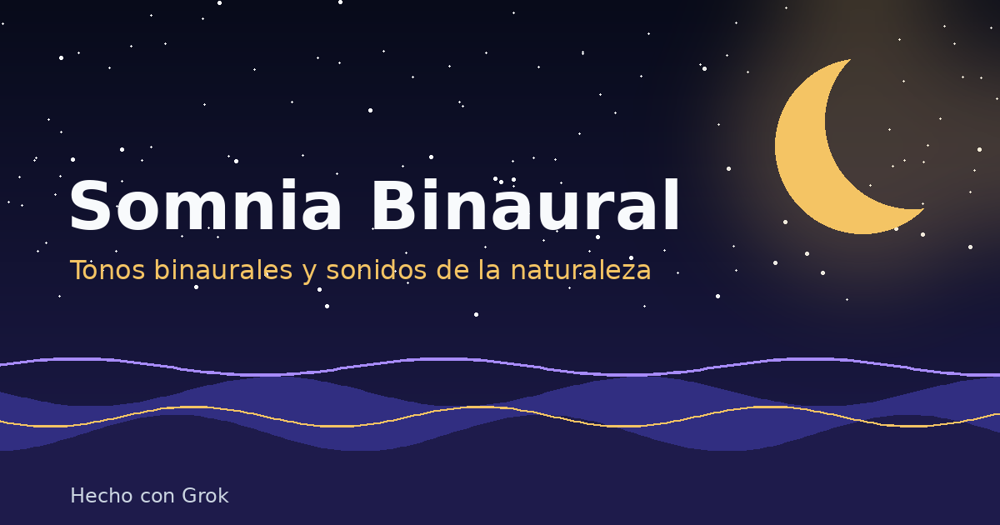

# Somnia Binaural

App de Android (Kotlin + Jetpack Compose) que genera **tonos binaurales** en tiempo real y los mezcla con **sonidos de la naturaleza** sintetizados (lluvia, olas, viento, grillos, arroyo y hoguera). Sin archivos de audio, sin internet y sin APIs de pago.



## Qué tiene
- 5 modos (Descanso Sereno, Siesta Revitalizante, Sueño Profundo, Sueño Reparador y Paz Crepuscular).
- Mezclador de 6 sonidos de la naturaleza y mezclas rápidas.
- Laboratorio Hz: portadora 70–432 Hz y pulso 0,5–15 Hz, modulación isocrónica e inversión de canales.
- Temporizador de 5 min a 8 h con atenuación progresiva.
- Sigue sonando con la pantalla apagada (servicio en primer plano con notificación: pausar, detener y tiempo restante).
- Respeta el foco de audio (llamadas, otras apps) y se pausa al desconectar los auriculares.
- Guarda tus mezclas, volúmenes y ajustes.

## Descargar
Descarga la APK desde [Releases](https://github.com/pekapro-lab/somnia/releases/latest). Android 7 (API 24) o superior.

> No es un tratamiento médico. Usa auriculares para el efecto binaural. No lo uses conduciendo.

## Compilar
```bash
./gradlew assembleRelease
```
La firma usa la clave Pekapro desde secretos de GitHub Actions (CI) o un `keystore.properties` local fuera del repositorio. Nunca se suben claves ni contraseñas.

## Licencia
AGPL-3.0. Hecho con Grok · Pekapro.
